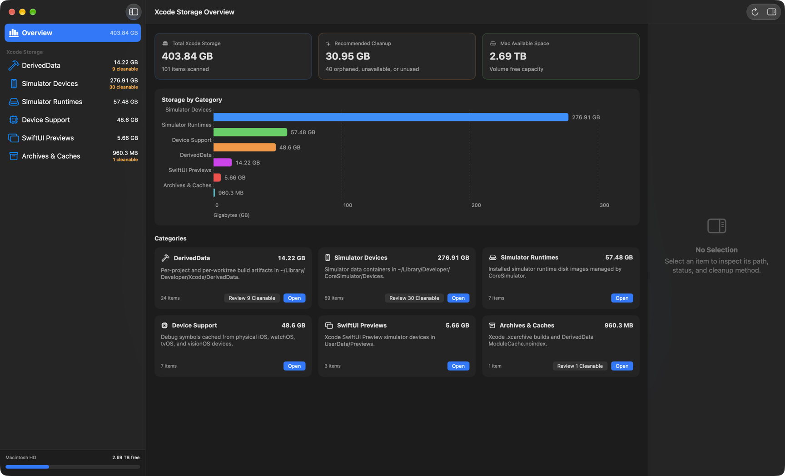

# XcodeSweep

A native macOS SwiftUI utility for inspecting and safely cleaning Xcode build and Simulator storage—especially orphaned `DerivedData` left behind by Git worktrees, oversized CoreSimulator devices, and unused Simulator runtime disk images.



## What It Scans

- **DerivedData** (`~/Library/Developer/Xcode/DerivedData`) — project build folders, recognized by an `info.plist` or Xcode's `<Project>-<hash>` name. In a custom DerivedData folder, the `info.plist` must be Xcode's (it records the workspace path), and other folders that aren't Xcode's known shared caches are listed as unrecognized, protected, and not counted. The `info.plist`'s workspace path identifies missing/orphaned workspaces and active Git worktrees, and last use determines whether other projects are unused; a hash-named folder without an `info.plist` is orphaned.
- **Simulator Devices** (`xcrun simctl list devices -j`) — shows allocated data + log size, runtime, boot state, and unavailable simulators.
- **Simulator Runtimes** (`xcrun simctl runtime list -j`) — lists installed iOS/watchOS/tvOS/visionOS disk images, build numbers, sizes, and last-used timestamps.
- **Device Support** (`~/Library/Developer/Xcode/* DeviceSupport`) — cached physical device symbols.
- **SwiftUI Previews** (`xcrun simctl --set previews list devices -j`, plus folders in `~/Library/Developer/Xcode/UserData/Previews/Simulator Devices` that `simctl` doesn't know).
- **Archives & Caches** (`~/Library/Developer/Xcode/Archives`, plus the caches Xcode shares across projects in `DerivedData`, such as `ModuleCache.noindex` and `SDKExplicitPrecompiledModules`).

XcodeSweep scans at launch. When you return to it, it rescans if the last completed scan is more than 15 minutes old, the app is idle, and no cleanup is awaiting confirmation.

Custom DerivedData and Archives locations set in Xcode's Settings → Locations are honored when they are absolute paths; a workspace-relative DerivedData location isn't scanned.

## Deletion Safety

- Filesystem items (`DerivedData`, `DeviceSupport`, leftover preview folders, `Archives`, shared caches) are moved to **Trash** (`FileManager.trashItem`) so deletions are reversible. If `simctl` can't list the preview set, preview folders are protected, since any of them might be registered.
- Simulator devices, registered preview devices, and runtime disk images are removed through **`xcrun simctl`** after explicit confirmation (XcodeSweep tries to shut each simulator down first).
- Every removal, failure, and item stopped mid-removal is recorded in the unified log: `/usr/bin/log show --last 1d --predicate 'subsystem == "com.kraigspear.XcodeSweep"'`.
- Quitting during a cleanup asks first: Stop and Quit finishes or stops the item in progress, removes nothing after it, then quits; Keep Running cancels the quit. The window can't be closed while a cleanup runs.
- App Sandbox is intentionally disabled (`com.apple.security.app-sandbox = false`) so the app can inspect `~/Library/Developer/` and invoke `/usr/bin/xcrun simctl`.

## Requirements

- macOS 15.0 or later
- Xcode 27 or later (project uses Xcode's native `project.xcproj` JSON format)

## Building & Testing

Build and test from the command line:

```bash
xcodebuild -project XcodeSweep.xcodeproj -scheme XcodeSweep -destination "platform=macOS" test
```

Open in Xcode:

```bash
open XcodeSweep.xcodeproj
```

## License

MIT License. See [LICENSE](LICENSE) for details.
